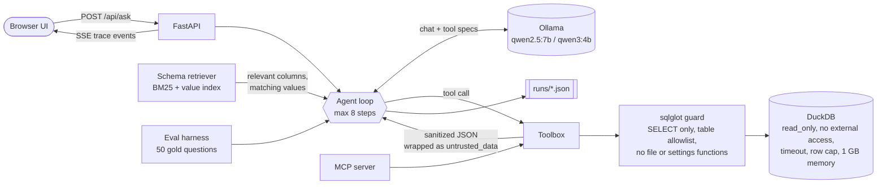
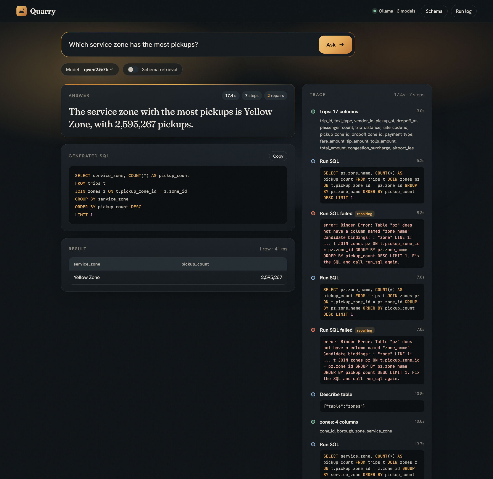
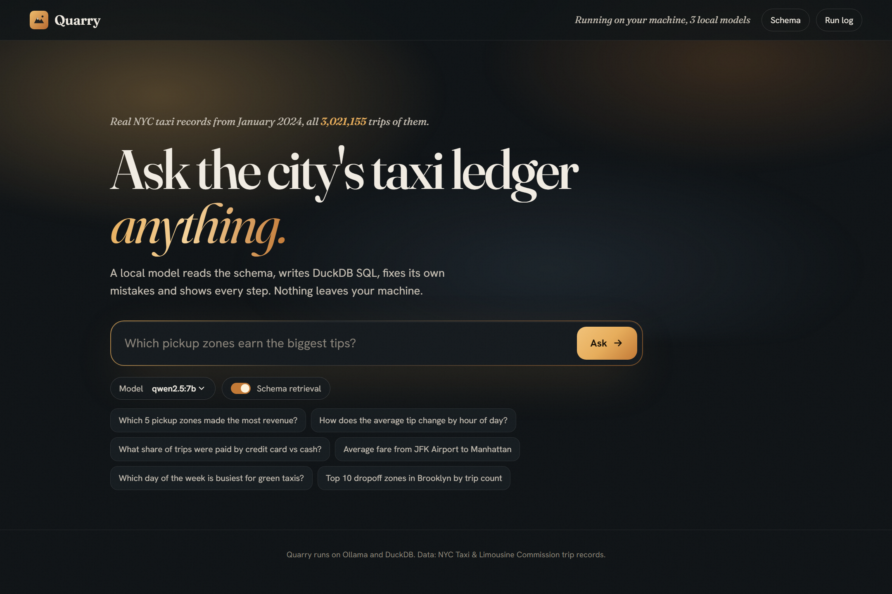

<p align="center"></p>

<h1 align="center">Quarry</h1>

<p align="center"><b>A text-to-SQL analyst agent that runs on a laptop GPU.</b><br>
Ask a business question about 3 million real NYC taxi trips. A local model explores the schema, writes DuckDB SQL,
fixes its own errors, charts the result and shows every step it took.</p>

<p align="center">
<a href="https://github.com/alok-kul5/quarry-sql/actions/workflows/ci.yml"></a>


</p>


## What it does

- **Tool-using agent loop.** The model gets five tools: `list_tables`, `describe_table`, `sample_rows`,
  `run_sql` and `make_chart`. It decides which to call, through Ollama's native tool calling.
- **Self-repair.** When a query fails, the DuckDB error goes back to the model as a tool result, together with the
  binder's "candidate bindings" hint. The model fixes the SQL and tries again, up to an 8-step budget.
- **Schema retrieval.** BM25 over column names and descriptions, plus an index of real categorical values. A question
  that says "JFK" finds `zones.zone = 'JFK Airport'`, so the model never has to guess a string literal.
- **Guardrails** that do not trust the model or the data (see [Guardrails](#guardrails)).
- **Trace view and run logs.** Every step streams to the UI over Server-Sent Events and is saved as JSON in `runs/`.
  Old runs can be replayed from the Run log panel.
- **Eval harness.** 50 questions with gold SQL, scored by execution accuracy, for two local models, with and without
  retrieval.
- **MCP server.** The same guarded tools are exposed over MCP (`python -m quarry.mcp_server`), so any MCP client can use them.

## Architecture



| Piece | File | Notes |
|---|---|---|
| Agent loop | [`quarry/agent.py`](quarry/agent.py) | Tool calls, repair, a nudge if the model answers without data, SQL pulled from prose as a fallback |
| Tools | [`quarry/tools.py`](quarry/tools.py) | Model sees at most 20 sanitized rows; the UI gets the full result |
| Guard | [`quarry/guard.py`](quarry/guard.py) | sqlglot AST walk, not regex |
| Database | [`quarry/db.py`](quarry/db.py) | Read-only connection, interrupt-based timeout, `fetchmany` row cap |
| Retrieval | [`quarry/retrieval.py`](quarry/retrieval.py) | BM25 over column docs, plus a value index of low-cardinality text columns |
| Server + UI | [`quarry/server.py`](quarry/server.py), [`quarry/web/`](quarry/web) | FastAPI, SSE, vanilla JS, Chart.js |
| Evals | [`evals/`](evals) | Questions, runner, scorer ([`quarry/scoring.py`](quarry/scoring.py)) and results |

## Results

<!-- results:start -->
50 questions ([`evals/questions.jsonl`](evals/questions.jsonl)): 15 easy, 23 medium and 12 hard, each with gold SQL. A run
passes when the agent's final result holds the gold rows. Row and column order are ignored, extra columns are
allowed, and numbers must agree to within a cent. The scorer is strict on purpose: a fraction is not a percentage,
and a per-day breakdown is not a weekday-versus-weekend answer. Temperature is 0 and the seed is fixed. Hardware is
an RTX 5050 laptop GPU with 8 GB, with Ollama running Q4_K_M weights.

| Model | Schema retrieval | Execution accuracy | Easy | Medium | Hard | Self-repairs that worked | Avg tool calls | Avg seconds |
|---|---|---|---|---|---|---|---|---|
| qwen2.5:7b | off | **70.2%** (33/47) | 14/15 | 15/23 | 4/9 | 5 | 3.1 | 4.6 |
| qwen2.5:7b | on | **92.0%** (46/50) | 15/15 | 21/23 | 10/12 | 0 | 1.2 | 2.5 |
| qwen3:4b | on | **92.0%** (46/50) | 15/15 | 20/23 | 11/12 | 0 | 1.2 | 131.5 |

Raw per-question results are in [`evals/results/`](evals/results). Reproduce them with `python evals/run_eval.py`.

**Coverage notes.** Three of the four planned runs are complete.
- **qwen3:4b with retrieval off was skipped for compute.** The GPU was shared with other jobs, which pushed it to
  about 10 questions an hour.
- **qwen2.5:7b with retrieval off covers questions 1 to 47.** Questions 48 to 50 hit Ollama outages, and the runner
  never scores those, so it reports 47.
- **Context and timing.** qwen3:4b ran with an 8192 context for questions 1 to 34 and 4096 after that, so it could share
  VRAM. Prompts are about 1.5k tokens, so nothing was cut off. Its average seconds reflect a shared, swapping GPU.
  qwen2.5:7b ran alone at about 2.5 s per question.

**What the numbers say**

- **Schema retrieval is worth about 22 points on qwen2.5:7b.** Without it the model has to explore with
  `describe_table` first, using about 3 tool calls instead of 1.2. Even then it often guesses a code instead of joining
  the lookup table: `payment_type = 2` for credit card is actually cash. With retrieval, the matching value
  (`payment_types.description = 'Credit card'`) sits in the prompt, and those questions pass.
- **With retrieval, the 4B model matches the 7B one** (both 92%). The schema context closes most of the gap a smaller
  model would otherwise have.
- **Self-repair matters when the model is exploring.** With retrieval off, 5 questions passed only after the model
  read a DuckDB binder error such as `Table "z" does not have a column named "zone_name". Candidate bindings: "zone"`
  and fixed its own query.
- **The remaining failures are real reasoning misses**, not plumbing. Both models answer "what share of all trips were
  paid by credit card" with an inner join that silently drops the 3,415 trips with no payment type: 78.06% against
  the true 77.97%. Other misses average a ratio wrongly, return seven weekdays when asked for weekend versus weekday,
  or guess a code for "disputed".
<!-- results:end -->

## Guardrails

The agent writes SQL that runs against real data, so every layer assumes the layer above it can fail.

| Threat | Defence |
|---|---|
| Model writes `DELETE`, `DROP`, `COPY`, `ATTACH`, `PRAGMA`, `SET` | sqlglot parses the query. Anything but a single `SELECT`/`WITH`/set operation is rejected, and so is any write node inside a CTE |
| Model reads local files (`read_csv`, `'file.csv'`, `glob`) | File and settings functions are blocklisted, and every table must be a known table or CTE. DuckDB also runs with `enable_external_access = false` |
| Guard bypass | The connection is `read_only=True` with `lock_configuration`, so even raw SQL cannot write |
| Runaway query | A timer calls `interrupt()` after 10 s. Results are capped with `fetchmany(500)`, and DuckDB memory is capped at 1 GB |
| Prompt injection planted in the data (a zone named "Ignore previous instructions...") | Tool results reach the model as JSON under `untrusted_data`. Values that look like instructions are replaced with `[withheld]` before the model sees them. Control and bidi characters are stripped and long strings are cut. The UI still shows the real value, rendered with `textContent` |
| Injection through retrieval | Retrieved data values pass through the same filter before they enter the system prompt |
| Path traversal on run logs | Run ids are matched against a strict pattern |

All of these are covered in [`tests/`](tests) (71 tests). A planted injection row in the fixture database is checked to
never reach the model's context.

## Run it

Needs Python 3.11 and [Ollama](https://ollama.com). No Docker, no API keys, nothing paid.

```bash
ollama pull qwen2.5:7b          # 4.7 GB, fits an 8 GB GPU
ollama pull qwen3:4b            # optional second model
py -3.11 -m venv .venv
.venv\Scripts\pip install -r requirements.txt
.venv\Scripts\python scripts\build_db.py     # downloads ~50 MB of TLC data, builds data/quarry.duckdb
.venv\Scripts\python -m uvicorn quarry.server:app --port 8765
```

Open http://localhost:8765. Pick a model and turn schema retrieval on or off from the controls under the question box.
`QUARRY_MODEL`, `QUARRY_NUM_CTX` (default 8192) and `OLLAMA_URL` change the defaults.

```bash
.venv\Scripts\python -m pytest -q                        # no GPU needed: the LLM is scripted
.venv\Scripts\python evals\run_eval.py                   # full eval, resumable
.venv\Scripts\python -m quarry.mcp_server                # MCP over stdio
```

## Data

[NYC Taxi & Limousine Commission trip records](https://www.nyc.gov/site/tlc/about/tlc-trip-record-data.page) for
January 2024: yellow and green taxis, 3,021,155 trips, joined to the 265 TLC taxi zones and to lookup tables for
vendors, payment types and rate codes. The build script adds column descriptions as DuckDB comments, which the agent
reads through `describe_table` and the retriever indexes.

| Table | Rows | What it is |
|---|---|---|
| `trips` | 3,021,155 | One row per trip: times, distance, zones, fare, tip, tolls, total |
| `zones` | 265 | Zone name, borough and service zone |
| `payment_types` | 7 | Credit card, cash, dispute, ... |
| `rate_codes` | 7 | Standard, JFK, Newark, negotiated, ... |
| `vendors` | 3 | Technology provider that logged the trip |

## Screens

| Live trace with a self-repair | Schema browser |
|---|---|
|  |  |



<p align="center"><sub>Built by <a href="https://alok.is-a.dev">Alok Kulkarni</a> · part of a portfolio of projects at <a href="https://github.com/alok-kul5">github.com/alok-kul5</a></sub></p>

---

<sub>One of eighteen projects by [Alok Kulkarni](https://alok.is-a.dev): [Hearth](https://github.com/alok-kul5/hearth-iot) home sensors · [Headway](https://github.com/alok-kul5/headway-transit) transit data · [Vigil](https://github.com/alok-kul5/vigil-soc) security triage · [Loupe](https://github.com/alok-kul5/loupe-vision) defect inspection · [Kharcha](https://github.com/alok-kul5/kharcha-finance) personal finance · [Stockroom](https://github.com/alok-kul5/stockroom-inventory) inventory · [Quietwire](https://github.com/alok-kul5/quietwire-villa) smart home design · [Canopy](https://alok.is-a.dev/canopy/) coffee storefront · [Picket](https://github.com/alok-kul5/picket) detection rules · [Warden](https://github.com/alok-kul5/warden-iac) cloud IaC scanning · [Marquee](https://github.com/alok-kul5/marquee-recs) recommendations · [Kestrel](https://github.com/alok-kul5/kestrel) fraud detection · [Almanac](https://github.com/alok-kul5/almanac-forecast) demand forecasting · **Quarry** data questions in plain English · [Quire](https://github.com/alok-kul5/quire) cited answers about Python · [Transit](https://github.com/alok-kul5/transit-mumbai) Mumbai trains · [Pulse](https://github.com/alok-kul5/pulse-habits) habit tracker · [Sieve](https://github.com/alok-kul5/sieve) job posts to clean data.</sub>
